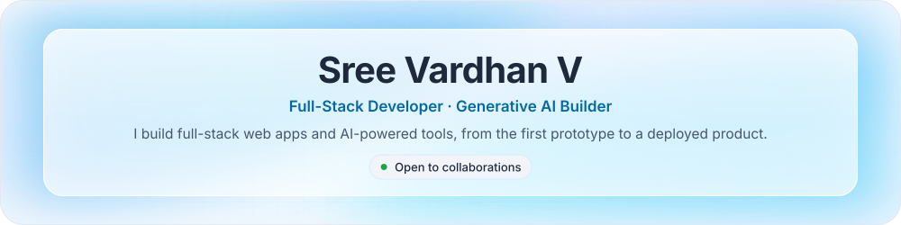
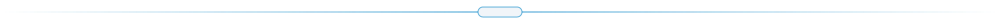
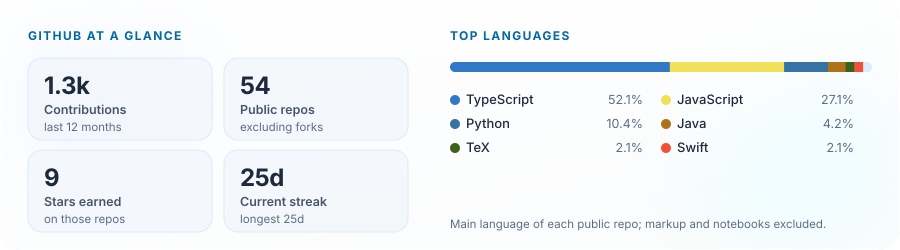

<!--
  Images live in assets/ and come in light and dark (and desktop and mobile) variants.
    python3 scripts/generate_glass.py                  hero, divider, project labels
    GITHUB_TOKEN=... python3 scripts/generate_stats.py stats cards (also daily via .github/workflows/stats.yml)
-->

  <picture>
    <source media="(max-width: 600px) and (prefers-color-scheme: dark)" srcset="https://raw.githubusercontent.com/vardhan23v/vardhan23v/main/assets/hero-mobile-dark.svg">
    <source media="(max-width: 600px)" srcset="https://raw.githubusercontent.com/vardhan23v/vardhan23v/main/assets/hero-mobile-light.svg">
    <source media="(prefers-color-scheme: dark)" srcset="https://raw.githubusercontent.com/vardhan23v/vardhan23v/main/assets/hero-dark.svg">
    
  </picture>

     

  <picture>
    <source media="(prefers-color-scheme: dark)" srcset="https://raw.githubusercontent.com/vardhan23v/vardhan23v/main/assets/divider-dark.svg">
    
  </picture>

## About me

I'm a computer science student who builds complete applications: from the interface and API down to the
database, and out to a live deployment. Most of my recent work combines full-stack engineering with
generative AI, from streaming LLM chat and tool-calling agents to multi-agent analysis pipelines.

- **Building with:** TypeScript, React and Next.js on the front, Node.js or FastAPI behind, PostgreSQL or MySQL underneath
- **Focused on:** generative and agentic AI, developer tools and real-time applications
- **Working style:** ship a working version early, then harden it with validation, tests and clear docs
- **Open to:** collaborative projects

  <picture>
    <source media="(prefers-color-scheme: dark)" srcset="https://raw.githubusercontent.com/vardhan23v/vardhan23v/main/assets/divider-dark.svg">
    
  </picture>

## Featured projects

<table>
  <tr>
    <td width="50%" valign="top">
      <picture>
        <source media="(prefers-color-scheme: dark)" srcset="https://raw.githubusercontent.com/vardhan23v/vardhan23v/main/assets/kicker-vard-ai-dark.svg">
        
      </picture>
      <h3><a href="https://github.com/vardhan23v/Vard-AI">Vard AI</a></h3>
      
A macOS desktop app that pairs a streaming AI chat with a coding agent that works on your own git projects.

      
<b>Key feature:</b> The agent plans first, runs each task in its own git worktree, asks before risky commands and shows the diff before anything merges. API keys stay in the macOS Keychain.

      
     

      

    </td>
    <td width="50%" valign="top">
      <picture>
        <source media="(prefers-color-scheme: dark)" srcset="https://raw.githubusercontent.com/vardhan23v/vardhan23v/main/assets/kicker-extension-ai-dark.svg">
        
      </picture>
      <h3><a href="https://github.com/vardhan23v/extension-AI">Extensio AI</a></h3>
      
Turns a plain-English prompt into a validated Manifest V3 Chrome extension you can edit, audit and ship.

      
<b>Key feature:</b> Four agents plan, write, check and review each extension live, then a browser IDE shows every AI change as a diff before it is saved.

      
     

      
 

    </td>
  </tr>
  <tr>
    <td width="50%" valign="top">
      <picture>
        <source media="(prefers-color-scheme: dark)" srcset="https://raw.githubusercontent.com/vardhan23v/vardhan23v/main/assets/kicker-trustlens-ai-dark.svg">
        
      </picture>
      <h3><a href="https://github.com/vardhan23v/trustlens-ai">TrustLens AI</a></h3>
      
Analyses an image, video, audio clip or text and returns an evidence-backed trust report instead of a bare real-or-fake label.

      
<b>Key feature:</b> CrewAI agents combine Gemini analysis, image forensics and rules, and the report states what could not be checked. Built at ACM × MLH Hack Days 2026.

      
    

      

    </td>
    <td width="50%" valign="top">
      <picture>
        <source media="(prefers-color-scheme: dark)" srcset="https://raw.githubusercontent.com/vardhan23v/vardhan23v/main/assets/kicker-hpl-auction-dark.svg">
        
      </picture>
      <h3><a href="https://github.com/vardhan23v/hpl-auction">HPL Auction</a></h3>
      
Runs a live cricket player auction for a six-team hostel league, with captains bidding from their phones.

      
<b>Key feature:</b> Server-authoritative bidding over WebSockets and transaction-safe sales with row locks, so every client sees the same timer and purse.

      
    

      
 

    </td>
  </tr>
  <tr>
    <td width="50%" valign="top">
      <picture>
        <source media="(prefers-color-scheme: dark)" srcset="https://raw.githubusercontent.com/vardhan23v/vardhan23v/main/assets/kicker-skyline-dark.svg">
        
      </picture>
      <h3><a href="https://github.com/vardhan23v/skyline_student-association">Skyline Student Association</a></h3>
      
Runs a student club from one platform: memberships and dues, event tickets, a merch shop, fundraisers and announcements.

      
<b>Key feature:</b> QR ticket check-in at the door and an append-only finance ledger for admins, in one TypeScript codebase deployed on Railway.

      
     

      
 

    </td>
    <td width="50%" valign="top">
      <picture>
        <source media="(prefers-color-scheme: dark)" srcset="https://raw.githubusercontent.com/vardhan23v/vardhan23v/main/assets/kicker-chitchain-dark.svg">
        
      </picture>
      <h3><a href="https://github.com/vardhan23v/chitchain">ChitChain</a></h3>
      
A testnet chit-fund prototype where the pot and collateral sit in a smart contract instead of with one organiser.

      
<b>Key feature:</b> An AI risk engine prices collateral and an agent can bid for members. Built in 24 hours for the MST × NEWRRO Buildathon 2026.

      
     

      

    </td>
  </tr>
</table>

<a href="https://github.com/vardhan23v?tab=repositories">Browse all repositories →</a>

  <picture>
    <source media="(prefers-color-scheme: dark)" srcset="https://raw.githubusercontent.com/vardhan23v/vardhan23v/main/assets/divider-dark.svg">
    
  </picture>

## Technology stack

<table>
<tr><td><b>Languages</b></td><td>          </td></tr>
<tr><td><b>Frontend</b></td><td>               </td></tr>
<tr><td><b>Backend</b></td><td>            </td></tr>
<tr><td><b>Databases</b></td><td>        </td></tr>
<tr><td><b>AI & agentic development</b></td><td>          </td></tr>
<tr><td><b>Testing</b></td><td>   </td></tr>
<tr><td><b>Tools & deployment</b></td><td>          </td></tr>
<tr><td><b>Exploring</b></td><td>    </td></tr>
</table>

  <picture>
    <source media="(prefers-color-scheme: dark)" srcset="https://raw.githubusercontent.com/vardhan23v/vardhan23v/main/assets/divider-dark.svg">
    
  </picture>

## GitHub activity

  <picture>
    <source media="(max-width: 600px) and (prefers-color-scheme: dark)" srcset="https://raw.githubusercontent.com/vardhan23v/vardhan23v/main/assets/stats-overview-mobile-dark.svg">
    <source media="(max-width: 600px)" srcset="https://raw.githubusercontent.com/vardhan23v/vardhan23v/main/assets/stats-overview-mobile-light.svg">
    <source media="(prefers-color-scheme: dark)" srcset="https://raw.githubusercontent.com/vardhan23v/vardhan23v/main/assets/stats-overview-dark.svg">
    
  </picture>

  

Generated daily from the GitHub API by a workflow in this repository. Public, non-fork repositories only.

  <picture>
    <source media="(prefers-color-scheme: dark)" srcset="https://raw.githubusercontent.com/vardhan23v/vardhan23v/main/assets/divider-dark.svg">
    
  </picture>

## Let's connect

I'm happy to talk about collaborations, or anything you're building with full-stack and AI.

     

