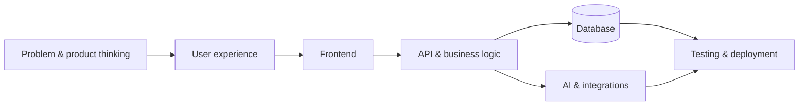

# Sree Vardhan V

### Full-Stack Developer · Generative AI Builder

I build thoughtful web products, AI-powered developer tools, and real-time applications — from the first prototype to a deployed experience.

  
  
  
  

  
  
  

---

## A little about me

I'm a computer science student who enjoys turning ideas into useful software. My work sits at the intersection of **full-stack development, generative AI, and practical product engineering**.

I like building beyond the happy path: connecting interfaces to real APIs and databases, designing clear user flows, integrating AI capabilities, and getting projects deployed.

- **Currently exploring:** Agentic AI, LLM-powered workflows, and developer tools
- **I enjoy building:** Full-stack applications, AI assistants, automation tools, and real-time experiences
- **My approach:** Ship useful things, learn from real problems, and keep improving the details
- **Open to:** Software development internships, collaborative projects, and meaningful opportunities

## Featured projects

<table>
  <tr>
    <td width="50%" valign="top" bgcolor="#F4FAFF">
      <strong><a href="https://github.com/vardhan23v/Vard-AI">Vard AI</a></strong> 
      A voice-first AI assistant with streaming conversations, persistent memory, and an extensible MCP tool system.  
      TanStack Start · React · TypeScript · Groq · Supabase · MCP
    </td>
    <td width="50%" valign="top" bgcolor="#F4FAFF">
      <strong><a href="https://github.com/vardhan23v/extension-AI">Extension AI</a></strong> 
      Generate Manifest V3 Chrome extensions from plain-English prompts, preview them, refine with AI, and download the result.  
      React · Node.js · Express · MongoDB · Gemini · Groq
    </td>
  </tr>
  <tr>
    <td width="50%" valign="top" bgcolor="#F4FAFF">
      <strong><a href="https://github.com/vardhan23v/Disastermind-ai">DisasterMind AI</a></strong> 
      A multi-agent cyclone-response simulation with a tactical map, coordinated response workflows, and explainable recommendations.  
      React · TypeScript · Leaflet · Zustand · Recharts
    </td>
    <td width="50%" valign="top" bgcolor="#F4FAFF">
      <strong><a href="https://github.com/vardhan23v/campus-compass">Campus Compass</a></strong> 
      A college discovery and comparison platform helping Indian students explore institutions, compare details, and read reviews.  
      Next.js · PostgreSQL · Prisma · NextAuth
    </td>
  </tr>
  <tr>
    <td width="50%" valign="top" bgcolor="#F4FAFF">
      <strong><a href="https://github.com/vardhan23v/ipl-auction">IPL Mega Auction</a></strong> 
      A multiplayer franchise auction platform with live bidding, independent rooms, and real-time updates.  
      Next.js · React · TypeScript · Socket.IO · Prisma · MySQL
    </td>
    <td width="50%" valign="top" bgcolor="#F4FAFF">
      <strong><a href="https://github.com/vardhan23v/chitchain">ChitChain</a></strong> 
      A testnet prototype exploring smart-contract-based fund custody, collateral, transparent settlement, and AI-assisted risk assessment.  
      Next.js · TypeScript · Solidity · FastAPI · CrewAI
    </td>
  </tr>
</table>

  <a href="https://github.com/vardhan23v?tab=repositories">Explore all repositories →</a>

## Technologies I work with

**Languages**

**Frontend & backend**

**Data, cloud & tools**

**AI & agentic development**

## How I think about building

I aim for a simple, maintainable flow: understand the problem, design the experience, build reliable application layers, integrate services carefully, and deploy something people can actually use.

## Let's connect

I'm always happy to connect with developers, founders, and teams working on interesting products.

  <a href="https://vardhan-v-portfilo.vercel.app/"><strong>Portfolio</strong></a> ·
  <a href="https://www.linkedin.com/in/vardhan-v23/"><strong>LinkedIn</strong></a> ·
  <a href="https://github.com/vardhan23v"><strong>GitHub</strong></a>

  Designed with a soft blue glass-inspired palette · Built with curiosity and consistency.

