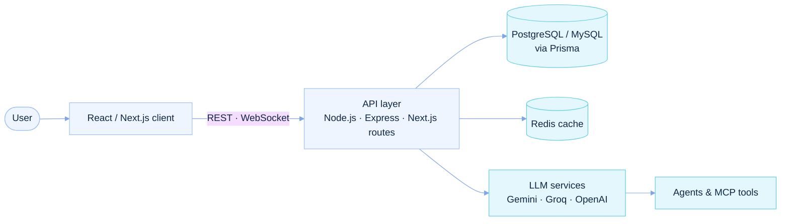
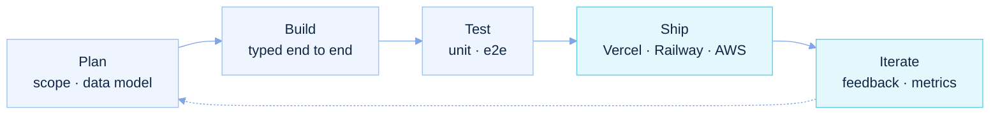

<!--
  The header and project cards are static SVGs in assets/, one light and one
  dark version each. Edit HEADER / PROJECTS and regenerate with:
      python3 scripts/generate_glass.py
-->

  <picture>
    <source media="(prefers-color-scheme: dark)" srcset="https://raw.githubusercontent.com/vardhan23v/vardhan23v/main/assets/header-dark.svg">
    
  </picture>

  
  
  

 

## A little about me

I'm a computer science student who enjoys turning ideas into useful software. My work sits at the intersection of **full-stack development, generative AI, and practical product engineering**.

I like building beyond the happy path: connecting interfaces to real APIs and databases, designing clear user flows, integrating AI capabilities, and getting projects deployed.

 

## Featured projects

**Languages** 

**Frameworks** 

**Data & Cloud** 

**AI / LLM** 

 

  <a href="https://github.com/vardhan23v/campus-compass"><picture>
    <source media="(prefers-color-scheme: dark)" srcset="https://raw.githubusercontent.com/vardhan23v/vardhan23v/main/assets/card-campus-compass-dark.svg">
    
  </picture></a>
  <a href="https://github.com/vardhan23v/ipl-auction"><picture>
    <source media="(prefers-color-scheme: dark)" srcset="https://raw.githubusercontent.com/vardhan23v/vardhan23v/main/assets/card-ipl-auction-dark.svg">
    
  </picture></a>

  <a href="https://github.com/vardhan23v/trustlens-ai"><picture>
    <source media="(prefers-color-scheme: dark)" srcset="https://raw.githubusercontent.com/vardhan23v/vardhan23v/main/assets/card-trustlens-ai-dark.svg">
    
  </picture></a>
  <a href="https://github.com/vardhan23v/chitchain"><picture>
    <source media="(prefers-color-scheme: dark)" srcset="https://raw.githubusercontent.com/vardhan23v/vardhan23v/main/assets/card-chitchain-dark.svg">
    
  </picture></a>

 

### Architecture

**Data, cloud & tools**

**AI & agentic development**

## How I think about building

I aim for a simple, maintainable flow: understand the problem, design the experience, build reliable application layers, integrate services carefully, and deploy something people can actually use.

### Workflow

 

  <a href="https://vardhan-v-portfilo.vercel.app/"><strong>Portfolio</strong></a> ·
  <a href="https://www.linkedin.com/in/vardhan-v23/"><strong>LinkedIn</strong></a> ·
  <a href="https://github.com/vardhan23v"><strong>GitHub</strong></a>

  Designed with a soft blue glass-inspired palette · Built with curiosity and consistency.

