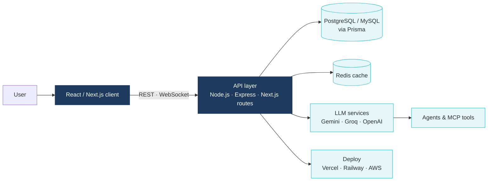

<h1 align="center">Vardhan V</h1>

  <strong>Full-Stack Developer · Generative AI Builder</strong> 
  I build production-ready web apps, real-time systems and AI-powered developer tools.

  
  
  

---

### About

Most student and small-team projects stop at a demo. I take mine to deployment: typed end to end,
backed by a real database, tested and live on the web.

My focus is where full-stack engineering meets generative AI: agent workflows, MCP tooling and
LLM features that hold up under real use, not only in a notebook.

- **Building:** AI-powered web apps, developer tools and real-time systems
- **Shipping on:** Vercel, Railway and AWS
- **Open to:** internships, collaborations and freelance work

### Tech Stack

**Languages** 

**Frameworks** 

**Data & Cloud** 

**AI / LLM** 

### Selected Work

| Project | What it does | Stack |
| --- | --- | --- |
| [**Campus Compass**](https://github.com/vardhan23v/campus-compass) | College discovery and comparison for Indian students: search, filter, compare and review, with recommendations. | Next.js · PostgreSQL · Prisma · NextAuth |
| [**IPL Auction**](https://github.com/vardhan23v/ipl-auction) | Live multiplayer auction rooms. Share a code, claim franchises and bid in real time from any phone. | Next.js · Socket.IO · Prisma · MySQL |
| [**TrustLens AI**](https://github.com/vardhan23v/trustlens-ai) | Checks screenshots, messages and viral claims and returns an explainable, evidence-backed trust report. | Python · CrewAI · Gemini |
| [**ChitChain**](https://github.com/vardhan23v/chitchain) | A trust-minimised chit fund. The pot lives in a smart contract, and an AI risk engine prices collateral. | TypeScript · Smart contracts · AI agents |

### How I Build

A typical project of mine follows the same shape: a typed web client, an API layer that owns
validation and auth, a relational database, and AI services kept behind the server.

---

  
    Vardhan V ·
    <a href="https://vardhan-v-portfilo.vercel.app/">Portfolio</a> ·
    <a href="https://www.linkedin.com/in/vardhan-v23/">LinkedIn</a> ·
    <a href="https://github.com/vardhan23v">GitHub</a>
  

